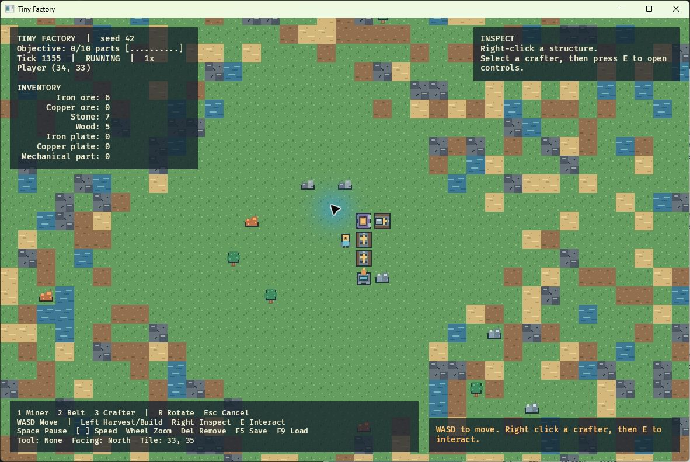

# Tiny Factory

A small 2D factory game built with a portable Rust simulation, a headless CLI, and a Bevy 0.19 desktop frontend. The world is 64×64 tiles. Mine iron, copper, and stone; route items on conveyors; craft ten mechanical parts.



The game remains active after completing the [ten-part objective](docs/images/objective-complete.png).

## Build

Install current stable Rust. On macOS, install Xcode command line tools. On Windows, install Visual Studio C++ build tools and Windows SDK. This repository was also tested on Windows with the GNU Rust target and the portable llvm-mingw toolchain. Then run:

```sh
cargo check --workspace
cargo test --workspace
cargo run -p factory-bevy
```

Run commands from the repository root so the game can find `assets/sprites`. The executable also accepts `--seed 123` for a new world and `--world path/to/save.json` to load or save a specific world. With no `--world`, F5 writes `tiny-factory-save.json` in the current directory and later launches load it automatically.

## Play

Move with WASD. Left click a nearby deposit to harvest; press 1, 2, or 3 to select a miner, conveyor, or crafter, then left click to build. Drag with the conveyor tool to lay a line. R changes the placement direction, or rotates a selected structure. Right click a structure to inspect it. For a crafter, press E to open controls, F1–F3 to choose a recipe, Tab to choose an item, and I/U/O to insert or withdraw items. Hold Shift with a transfer key to move five. Escape closes the controls or cancels a tool. Space pauses, brackets change simulation speed, the wheel zooms, Delete removes the selected structure, and F5/F9 save or reload.

The goal is ten mechanical parts. Iron plates need two iron ore each; mechanical parts need two iron plates and one wood. Trees are harvested manually, so carry wood to a mechanical-part crafter.

## Headless quick start

```sh
cargo run -p factory-cli --bin factoryctl -- new --seed 42 --output world.json
cargo run -p factory-cli --bin factoryctl -- summary --world world.json --json
cargo run -p factory-cli --bin factoryctl -- move --world world.json --direction east
cargo run -p factory-cli --bin factoryctl -- harvest --world world.json --x 35 --y 31
cargo run -p factory-cli --bin factoryctl -- step --world world.json --ticks 100
cargo run -p factory-cli --bin factoryctl -- validate --world world.json
cargo run -p factory-cli --bin factoryctl -- scenario --file scenarios/crafting-test.json --json
cargo run --release -p factory-cli --bin factoryctl -- bench --world world.json --ticks 1000 --samples 5 --json
```

The CLI executable is named `factoryctl`. See [docs/cli.md](docs/cli.md) for all commands and scenario semantics. [AGENTS.md](AGENTS.md) has the verification workflow; [docs/architecture.md](docs/architecture.md) describes the engine boundary.

[Verification results](docs/verification.md) record the workspace gates, CLI scenarios, and live game checks.

For a deterministic screenshot without a graphics window, install a current Node.js and run `node tools/render_preview.mjs world.json preview.png 32 32`. This renders the saved scene from the same sprites the frontend uses; it is a headless preview, while the running game adds UI, camera movement, and animation.
